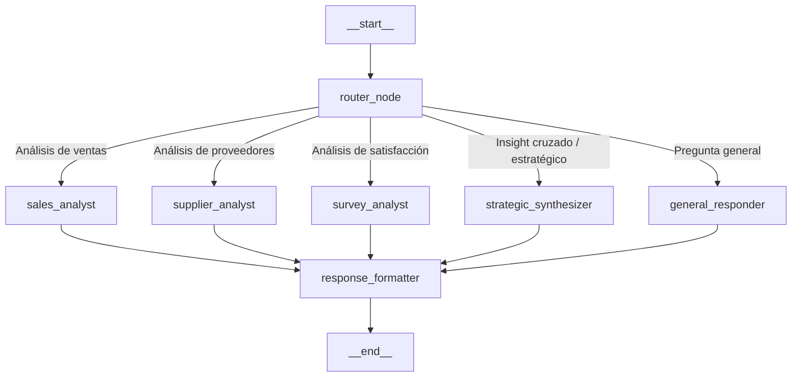

# 🧠 Agente Estratégico de Cafetería Universitaria — LangGraph

## Visión General

Agente conversacional multi-fuente construido con **LangGraph** que integra datos de ventas transaccionales, reportes de proveedores y encuestas de satisfacción estudiantil para generar **insights estratégicos accionables** orientados a revertir la caída del ~20% en ventas de la cafetería universitaria.

---

## 1. Objetivo Estratégico

| Dimensión | Descripción |
|---|---|
| **Problema central** | Caída sostenida del ~20% en ingresos durante 2025 (de Ene a Dic) |
| **Meta del agente** | Diagnosticar causas raíz, identificar oportunidades y generar recomendaciones estratégicas basadas en datos |
| **Usuario objetivo** | Director de servicios universitarios, coordinador de cafetería, equipo administrativo |
| **Modo de interacción** | Conversación en lenguaje natural con respuestas respaldadas por datos cuantitativos |

---

## 2. Fuentes de Datos

### 2.1 `ventas_cafeteria.csv` — Transacciones POS

| Campo | Tipo | Ejemplo |
|---|---|---|
| `ID de Compra` | string | `CAF-00001` |
| `Fecha` | date | `2025-01-01` |
| `Hora` | time | `07:05:49` |
| `Nombre de Producto` | string | `Galleta con Chispas` |
| `Cantidad` | int | `1` |
| `Precio Unitario` | float | `1.20` |
| `Valor Total` | float | `1.20` |

- **Volumen**: ~20,000 transacciones
- **Periodo**: 2025-01-01 a 2025-12-31
- **Productos**: 13 SKUs (Café Americano, Café Latte, Capuccino, Té Helado, Agua Embotellada, Refresco, Sandwich de Pollo, Sandwich Vegetariano, Croissant, Galleta con Chispas, Muffin de Arándanos, Ensalada César, Empanada de Carne)
- **Horario**: 07:00–19:59
- **Tendencia clave**: Declive lineal ~20% en frecuencia de transacciones a lo largo del año

### 2.2 `reportes_proveedores.json` — Cadena de Suministro

| Campo clave | Descripción |
|---|---|
| `proveedor.nombre` | 5 proveedores (Café Premium, Bebidas del Valle, El Trigal, Frescos & Proteínas, Lácteos San Miguel) |
| `proveedor.categoria` | Bebidas calientes, Bebidas frías, Panadería/repostería, Proteínas/frescos, Lácteos |
| `volumen_pedido` | Unidades solicitadas, devueltas, netas + costos USD |
| `entregas` | Programadas, cumplidas, tasa de cumplimiento |
| `puntualidad_pago_cafeteria` | Puntual / Atraso leve |
| `calificacion_servicio_proveedor` | 1.0–5.0 |
| `factor_demanda_relativo` | Decrece de ~0.992 (Ene) a ~0.808 (Dic) |

- **Volumen**: 60 reportes (5 proveedores × 12 meses)
- **Mapeo**: Cada proveedor está vinculado a productos específicos de la cafetería

### 2.3 `encuestas_estudiantes.json` — Voz del Cliente

| Campo clave | Descripción |
|---|---|
| `estudiante` | nombre, género, carrera, semestre, id |
| `frecuencia_visita` | Diariamente / 3-4 veces / 1-2 veces / Ocasionalmente |
| `gasto_semanal_estimado_usd` | Float |
| `producto_mas_consumido` | Producto favorito del estudiante |
| `calificaciones` | calidad_alimentos, variedad_menu, atencion_servicio, relacion_precio_calidad, limpieza_ambiente, satisfaccion_general |
| `recomienda_cafeteria` | boolean |
| `comentario` | Texto libre con opiniones |

- **Volumen**: 2,400 encuestas
- **Carreras**: ~15+ programas académicos
- **Tendencia clave**: Deterioro progresivo en calificaciones coherente con la caída en ventas

---

## 3. Arquitectura del Agente — LangGraph

### 3.1 Diagrama de Flujo del Grafo



### 3.2 Definición del State

```python
from typing import TypedDict, Annotated, Literal
from langgraph.graph.message import add_messages

class CafeteriaAgentState(TypedDict):
    # Historial conversacional
    messages: Annotated[list, add_messages]
    
    # Clasificación de la consulta
    query_type: Literal[
        "ventas", "proveedores", "satisfaccion", 
        "estrategico", "general"
    ]
    
    # Datos cargados (se inyectan al inicio)
    sales_summary: dict        # Resumen pre-computado del CSV
    supplier_data: list[dict]  # Reportes de proveedores
    survey_summary: dict       # Resumen pre-computado de encuestas
    
    # Resultado del análisis del nodo especialista
    analysis_result: str
    
    # Fuentes citadas en la respuesta
    sources_cited: list[str]
```

### 3.3 Descripción de Nodos

| Nodo | Responsabilidad | Herramientas |
|---|---|---|
| **`router_node`** | Clasifica la pregunta del usuario en una de 5 categorías usando el LLM | — |
| **`sales_analyst`** | Análisis cuantitativo de ventas: tendencias, estacionalidad, productos top/bottom, horas pico, ticket promedio | `pandas` code execution |
| **`supplier_analyst`** | Evaluación de proveedores: cumplimiento, costos, devoluciones, calidad, riesgos de abastecimiento | JSON querying |
| **`survey_analyst`** | Análisis de satisfacción: NPS, sentiment de comentarios, correlaciones demográficas, puntos de dolor | NLP + estadísticas |
| **`strategic_synthesizer`** | Cruza insights de los 3 dominios para respuestas de nivel ejecutivo | Invoca internamente a los 3 analistas |
| **`response_formatter`** | Formatea la respuesta final con tablas, métricas clave y recomendaciones accionables | Markdown rendering |
| **`general_responder`** | Maneja preguntas fuera de alcance o conversacionales | — |

---

## 4. Stack Tecnológico

### 4.1 Core

| Componente | Tecnología | Versión | Justificación |
|---|---|---|---|
| **Orquestación** | `langgraph` | ≥0.2 | Grafo stateful con routing condicional |
| **LLM** | `langchain-openai` (GPT 5.4 Nano / 5.4 Mini) | latest | Alterna entre Nano (consultas simples/router) y Mini (análisis complejos/síntesis) |
| **Framework** | `langchain-core` | ≥0.3 | Prompts, output parsers, tool calling |
| **Runtime** | Python | 3.11+ | Ecosistema de data science y entorno virtual |

### 4.2 Procesamiento de Datos

| Librería | Uso |
|---|---|
| `pandas` | Carga, transformación y análisis del CSV de ventas |
| `numpy` | Cálculos estadísticos (medias móviles, regresiones) |

### 4.3 Interfaz de Usuario

| Opción | Tecnología | Notas |
|---|---|---|
| **Aplicación Web** | Reflex | Chat UI construida en Python puro, utilizando el logo en `assets/Logos Unidades_Café du Nord (1)-Photoroom.png` como referencia estética para el frontend |
| **Entorno** | Virtual Environment | Despliegue empaquetado y reproducible con entorno virtual (`venv`) |

### 4.4 Observabilidad

| Herramienta | Propósito |
|---|---|
| LangSmith | Tracing de ejecuciones, latencia, costos por nodo |

---

## 5. Estrategia de Procesamiento de Datos

### 5.1 Pipeline de Pre-carga

Dado que los datasets son estáticos (año 2025), se pre-computan resúmenes al iniciar el agente para reducir tokens consumidos por invocación:

```python
# Pseudo-código del pipeline de inicialización
def build_sales_summary(csv_path: str) -> dict:
    df = pd.read_csv(csv_path)
    df["Fecha"] = pd.to_datetime(df["Fecha"])
    df["Mes"] = df["Fecha"].dt.month
    df["Hora_int"] = df["Hora"].str[:2].astype(int)
    
    return {
        "total_transacciones": len(df),
        "ingreso_total": df["Valor Total"].sum(),
        "ticket_promedio": df["Valor Total"].mean(),
        "ventas_por_mes": df.groupby("Mes")["Valor Total"].sum().to_dict(),
        "transacciones_por_mes": df.groupby("Mes").size().to_dict(),
        "top_productos_ingreso": (
            df.groupby("Nombre de Producto")["Valor Total"]
            .sum().sort_values(ascending=False).head(5).to_dict()
        ),
        "distribucion_horaria": df.groupby("Hora_int").size().to_dict(),
        "tendencia_declive_pct": calcular_declive(df),
    }
```

### 5.2 Inyección de Contexto

Los resúmenes se inyectan en el `system_prompt` de cada nodo especialista, evitando enviar datos crudos al LLM:

```
Tienes acceso a los siguientes datos pre-computados:
{sales_summary_json}
Usa exclusivamente estos datos para responder. Cita métricas específicas.
```

---

## 6. Prompts del Sistema por Nodo

### 6.1 Router

```
Eres un clasificador de preguntas para una cafetería universitaria.
Clasifica la pregunta del usuario en UNA de estas categorías:
- "ventas": sobre ingresos, transacciones, productos, tendencias de venta
- "proveedores": sobre abastecimiento, costos de insumos, cumplimiento, calidad
- "satisfaccion": sobre opiniones, calificaciones, quejas, demografía estudiantil
- "estrategico": requiere cruzar 2+ fuentes para responder, o pide recomendaciones
- "general": saludo, pregunta fuera de alcance, o aclaración
Responde SOLO con la categoría.
```

### 6.2 Sales Analyst

```
Eres un analista de datos senior de la cafetería universitaria "Café du Nord".
CONTEXTO: La cafetería experimentó una caída del ~20% en ventas durante 2025.
DATOS DISPONIBLES: {sales_summary}
INSTRUCCIONES:
1. Responde con datos cuantitativos específicos (cifras, porcentajes, comparativas)
2. Identifica patrones temporales (mensual, por hora, día de semana)
3. Señala anomalías o puntos de inflexión
4. Proporciona contexto para cada métrica
```

### 6.3 Strategic Synthesizer

```
Eres el asesor estratégico senior de la cafetería universitaria.
Tienes acceso a 3 fuentes de datos:
1. VENTAS: {sales_summary}
2. PROVEEDORES: {supplier_summary}
3. ENCUESTAS: {survey_summary}

INSTRUCCIONES:
1. Cruza información de múltiples fuentes para generar insights
2. Identifica correlaciones causa-efecto
3. Prioriza recomendaciones por impacto estimado y facilidad de implementación
4. Estructura: Diagnóstico → Hallazgos clave → Recomendaciones → KPIs de seguimiento
```

---

## 7. Preguntas Estratégicas que el Agente Debe Resolver

### Nivel Diagnóstico
- ¿Cuáles son las principales causas de la caída del 20% en ventas?
- ¿Existe correlación entre la satisfacción estudiantil y el volumen de ventas mensual?
- ¿Qué productos muestran la mayor y menor resiliencia en ventas?

### Nivel Táctico
- ¿En qué franjas horarias se pierden más ventas potenciales?
- ¿Qué proveedores presentan riesgos de calidad que impactan la percepción del cliente?
- ¿Qué carreras o perfiles de estudiante están abandonando la cafetería más rápido?

### Nivel Estratégico
- ¿Qué plan de acción de 90 días revertiría la tendencia de ventas?
- ¿Cómo optimizar el mix de productos para maximizar margen y satisfacción?
- ¿Qué inversiones en calidad de servicio tendrían el mayor ROI?

---

## 8. Estructura de Archivos del Proyecto

```
Ventas_cafeteria/
├── venv/                              # Entorno virtual aislado
├── agents.md                          # ← Este documento
├── ventas_cafeteria.csv               # 20K transacciones POS
├── reportes_proveedores.json          # 60 reportes mensuales
├── encuestas_estudiantes.json         # 2,400 encuestas
├── generador_ventas.py                # Script generador del CSV
├── generador_encuestas_proveedores.py # Script generador JSON
│
├── assets/                            # Recursos estáticos
│   └── Logos Unidades_Café du Nord (1)-Photoroom.png
│
├── agent/                             # [NUEVO] Código del agente
│   ├── __init__.py
│   ├── graph.py                       # Definición del grafo LangGraph
│   ├── state.py                       # TypedDict del estado
│   ├── nodes/
│   │   ├── router.py                  # Nodo clasificador
│   │   ├── sales_analyst.py           # Analista de ventas
│   │   ├── supplier_analyst.py        # Analista de proveedores
│   │   ├── survey_analyst.py          # Analista de encuestas
│   │   ├── strategic_synthesizer.py   # Sintetizador estratégico
│   │   └── response_formatter.py      # Formateador de respuesta
│   ├── tools/
│   │   ├── data_loader.py            # Carga y pre-procesamiento
│   │   └── analytics.py              # Funciones de análisis reutilizables
│   └── prompts/
│       └── system_prompts.py          # Todos los prompts centralizados
│
├── chatapp/                           # Punto de entrada y frontend (Reflex)
│   └── chatapp.py                     # Lógica principal de UI y estado
├── rxconfig.py                        # Configuración de Reflex
├── requirements.txt
└── .env                               # OPENAI_API_KEY
```

---

## 9. Construcción del Grafo — Pseudo-código

```python
from langgraph.graph import StateGraph, END
from agent.state import CafeteriaAgentState
from agent.nodes import (
    router, sales_analyst, supplier_analyst,
    survey_analyst, strategic_synthesizer,
    general_responder, response_formatter
)

def route_query(state: CafeteriaAgentState) -> str:
    """Routing condicional basado en la clasificación."""
    return state["query_type"]

# Construcción del grafo
builder = StateGraph(CafeteriaAgentState)

# Agregar nodos
builder.add_node("router_node", router.classify_query)
builder.add_node("sales_analyst", sales_analyst.analyze)
builder.add_node("supplier_analyst", supplier_analyst.analyze)
builder.add_node("survey_analyst", survey_analyst.analyze)
builder.add_node("strategic_synthesizer", strategic_synthesizer.synthesize)
builder.add_node("general_responder", general_responder.respond)
builder.add_node("response_formatter", response_formatter.format_output)

# Entry point
builder.set_entry_point("router_node")

# Routing condicional
builder.add_conditional_edges(
    "router_node",
    route_query,
    {
        "ventas": "sales_analyst",
        "proveedores": "supplier_analyst",
        "satisfaccion": "survey_analyst",
        "estrategico": "strategic_synthesizer",
        "general": "general_responder",
    }
)

# Todos los analistas convergen en el formateador
for node in ["sales_analyst", "supplier_analyst", "survey_analyst",
             "strategic_synthesizer", "general_responder"]:
    builder.add_edge(node, "response_formatter")

builder.add_edge("response_formatter", END)

# Compilar
graph = builder.compile()
```

---

## 10. Dependencias (`requirements.txt`)

```
langgraph>=0.2.0
langchain-core>=0.3.0
langchain-openai>=0.2.0
pandas>=2.2.0
numpy>=1.26.0
reflex>=0.4.0
python-dotenv>=1.0.0
```

---

## 11. Métricas de Éxito del Agente

| Métrica | Target | Método de medición |
|---|---|---|
| Precisión de routing | ≥95% | Test set de 50 preguntas etiquetadas |
| Relevancia de respuestas | ≥4.0/5.0 | Evaluación humana (rúbrica) |
| Citación de datos | 100% | Toda respuesta cuantitativa incluye fuente |
| Latencia p95 | <8s | LangSmith tracing |
| Cobertura de preguntas estratégicas | 100% | Validación contra §7 de este documento |

---

## 12. Roadmap de Implementación

| Fase | Entregable | Estimado |
|---|---|---|
| **Fase 1** — Data Layer | `data_loader.py` + `analytics.py` con resúmenes pre-computados | 1 día |
| **Fase 2** — Nodos Base | Router + 3 analistas especializados funcionales | 2 días |
| **Fase 3** — Synthesizer | Nodo estratégico con cross-referencing de fuentes | 1 día |
| **Fase 4** — UI | Interfaz Reflex (virtual env, con logo e historial) | 1 día |
| **Fase 5** — Polish | Prompts refinados, edge cases, test suite | 1 día |
