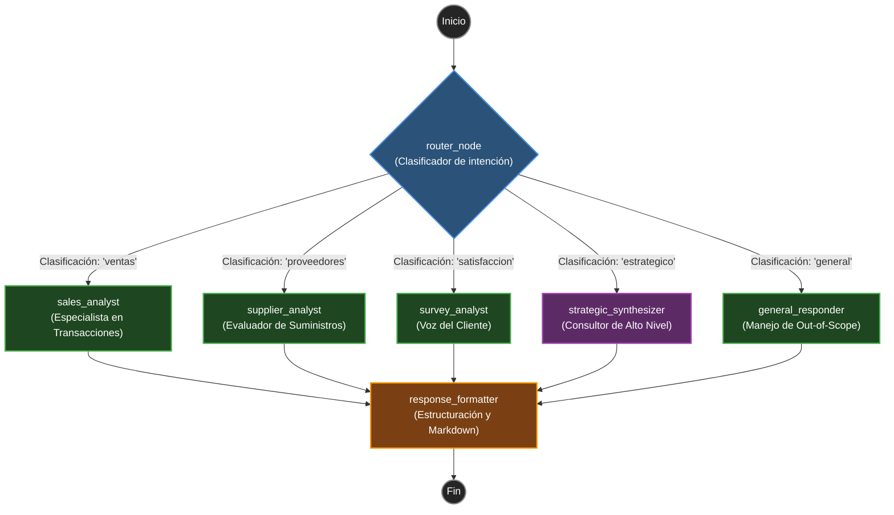

# Arquitectura y Flujo de LangGraph - Cafetería

A continuación se detalla la arquitectura del agente conversacional para la cafetería universitaria, basado en LangGraph.

## Diagrama del Flujo

## Explicación del Flujo Paso a Paso

1. **Entrada (`__start__`)**: El usuario (el director o coordinador de la cafetería) envía un mensaje o pregunta en lenguaje natural desde la interfaz desarrollada en Reflex.
2. **Clasificación Condicional (`router_node`)**: El sistema utiliza un LLM rápido/ligero para clasificar la intención de la consulta en 1 de 5 dominios predefinidos. Esto evita enviar contexto irrelevante al modelo en los pasos posteriores y ahorra tokens.
3. **Nodos Especialistas (El Análisis)**: Según el resultado del Router, el estado del grafo se enruta a un experto:
   - **`sales_analyst`**: Analiza caídas de ingresos, productos más vendidos, y métricas transaccionales basado en los datos del punto de venta.
   - **`supplier_analyst`**: Evalúa entregas de proveedores, calidad y problemas de abastecimiento en la cadena de suministro.
   - **`survey_analyst`**: Examina el _feedback_ cualitativo y cuantitativo de las encuestas estudiantiles.
   - **`strategic_synthesizer`**: Se activa para preguntas ejecutivas o planes de acción. Toma en cuenta el cruce de los 3 dominios de datos para encontrar correlaciones (ej. *¿Afectan las demoras del proveedor "Lácteos San Miguel" a las ventas matutinas del Capuccino?*).
   - **`general_responder`**: Resuelve consultas genéricas o saludos, evitando gastar recursos analíticos en preguntas que no corresponden a métricas.
4. **Formateo de la Salida (`response_formatter`)**: Independientemente del especialista que haya procesado la información, el resultado confluye en este nodo. Aquí se le da un formato estructurado y pulido (con tablas, métricas destacadas y recomendaciones accionables) de nivel ejecutivo.
5. **Fin (`__end__`)**: El agente finaliza su estado y se envía la respuesta formateada de vuelta al historial conversacional.
